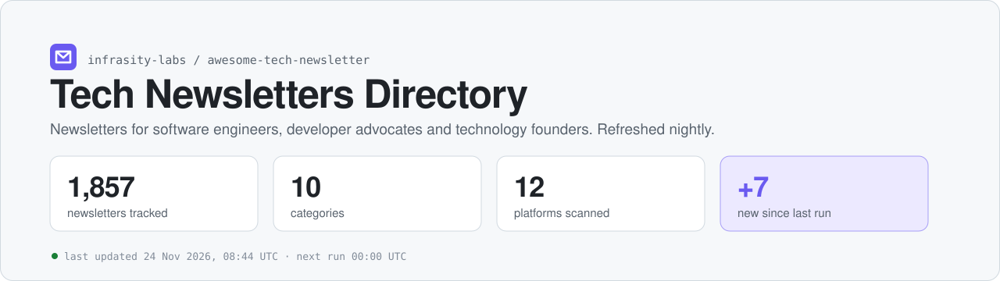
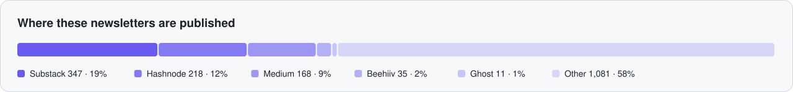

  

  <picture>
    <source media="(prefers-color-scheme: dark)" srcset="./.github/assets/banner-dark.svg">
    
  </picture>

  
  
  
  
  
  

  <b>A community-curated directory of newsletters for software engineers, developer advocates and technology founders.</b> 
  From enterprise architecture to the newest frameworks, plus the B2B and developer-marketing newsletters that cover the business side.

  <a href="#browse-by-category"><b>Browse categories</b></a> &nbsp;·&nbsp;
  <a href="#how-it-works"><b>How it works</b></a> &nbsp;·&nbsp;
  <a href="https://github.com/Infrasity-Labs/awesome-tech-newsletter/issues/new?template=submit_newsletter.md"><b>Submit a newsletter</b></a> &nbsp;·&nbsp;
  <a href="https://github.com/Infrasity-Labs/awesome-tech-newsletter/subscription"><b>Watch for updates</b></a>

<!-- DIRECTORY:START -->

## Browse by category

| Category | Newsletters | New | |
|:--|--:|--:|:--|
| [General Software Engineering](#general-software-engineering) | **248** | +1 | <picture>   <source media="(prefers-color-scheme: dark)" srcset="./.github/assets/bars/general-software-engineering-dark.svg">    </picture> |
| [Backend Development](#backend-development) | **215** | — | <picture>   <source media="(prefers-color-scheme: dark)" srcset="./.github/assets/bars/backend-development-dark.svg">    </picture> |
| [System Design & Architecture](#system-design--architecture) | **75** | — | <picture>   <source media="(prefers-color-scheme: dark)" srcset="./.github/assets/bars/system-design-architecture-dark.svg">    </picture> |
| [Language Specific](#language-specific) | **240** | +1 | <picture>   <source media="(prefers-color-scheme: dark)" srcset="./.github/assets/bars/language-specific-dark.svg">    </picture> |
| [DevOps & Cloud](#devops--cloud) | **208** | +1 | <picture>   <source media="(prefers-color-scheme: dark)" srcset="./.github/assets/bars/devops-cloud-dark.svg">    </picture> |
| [GTM](#gtm) | **123** | — | <picture>   <source media="(prefers-color-scheme: dark)" srcset="./.github/assets/bars/gtm-dark.svg">    </picture> |
| [Developer Marketing](#developer-marketing) | **41** | — | <picture>   <source media="(prefers-color-scheme: dark)" srcset="./.github/assets/bars/developer-marketing-dark.svg">    </picture> |
| [Technical Content Marketing](#technical-content-marketing) | **7** | — | <picture>   <source media="(prefers-color-scheme: dark)" srcset="./.github/assets/bars/technical-content-marketing-dark.svg">    </picture> |
| [Frontend Development](#frontend-development) | **269** | — | <picture>   <source media="(prefers-color-scheme: dark)" srcset="./.github/assets/bars/frontend-development-dark.svg">    </picture> |
| [Data Science & AI](#data-science--ai) | **440** | — | <picture>   <source media="(prefers-color-scheme: dark)" srcset="./.github/assets/bars/data-science-ai-dark.svg">    </picture> |

Bars share one scale. Each category links to its full list.

## Where they are published

<picture>
  <source media="(prefers-color-scheme: dark)" srcset="./.github/assets/platform-mix-dark.svg">
  
</picture>

## General Software Engineering

Broad engineering newsletters: craft, careers, tools and industry news that cut across stacks. 
<b>248</b> newsletters · <b>1</b> new since the last run · <a href="directory/general-software-engineering.md">view all</a> · <a href="#browse-by-category">back to top ↑</a>

| Name | Link | Description | Frequency |
|------|------|-------------|-----------|
| **A hacker got inside 1Password through one employee's GitHub account**  | [↗](https://vxsure.hashnode.dev) | 1Password's 25 Nov 2026 update, read closely: how the attacker got in, what was copied, why... | Varies |
| **3AM Files: Merged Before Coffee** | [↗](https://honeykiran.substack.com) | Hypothetical Tuesday. None of this happened — which is exactly why it keeps happening. Nothing... | Varies |
| **A 7M-Param Model Just Beat GPT on ARC. Now What?** | [↗](https://interestingengineering.substack.com) | Samsung's tiny recursive model outscored frontier LLMs on ARC-AGI while GitHub's minimind hit 57k stars. What this means for builders. | Varies |
| **A Case for Monolith** | [↗](https://charlesfonseca.substack.com) | I write because I can't stop. Systems, Programming, Database, Cloud. | Varies |
| **A Queue Is a Promise About the Future** | [↗](https://rodrigovidal.substack.com) | Accepting work is easy. Finishing it on time is the promise. An application does not have to finish... | Varies |
| **A user couldn't read my app. He was right.** | [↗](https://wafflehacker.substack.com) | A little while back somebody wrote in about AntiFreeze via the Signal support channel: Hi! Thanks... | Varies |
| **Adding Homemade TLS to a Homemade Web Server** | [↗](https://open.substack.com) | Original series: Building Your Own Web Server + Rebuilding TLS from Scratch This article connects... | Varies |
| **Adrien Cadet** | [↗](https://medium.com/@CadetAdrien) | Read writing from Adrien Cadet on Medium. Junior Software Engineer | Varies |

<b>Show 12 more</b>

| Name | Link | Description | Frequency |
|------|------|-------------|-----------|
| **Advanced Prompt Engineering Techniques** | [↗](https://rahulvijayvergiya.hashnode.dev) | Why Do We Need Advanced Prompting? Imagine you hire a new assistant. If you simply... | Varies |
| **Agentic Coding with Discipline and Skill** | [↗](https://agenticcoding.substack.com) | Bring the practice of agentic coding to the next level so it's production-ready. | Varies |
| **Agents, harnessed** | [↗](https://codagent.beehiiv.com) | Newsletter about coding agent harnesses and harness engineering. | Varies |
| **Android Authority Weekly** | [↗](https://duckduckgo.com/?q=!ducky+%22Android+Authority+Weekly%22+newsletter) | Android news, reviews, articles, and more! | Varies |
| **Android Authority Weekly** | [↗](https://duckduckgo.com/?q=!ducky+"Android+Authority+Weekly"+newsletter) | Android news, reviews, articles, and more! | Varies |
| **Better Engineers** | [↗](https://betterengineers.substack.com) | A Programmer's Journey of Perfections  Follow  LinkedIn: https://www.linkedin.com/in/devd04/ X : https://x.com/BetterEngineer1 | Varies |
| **BroncoCTF : Spot the difference Writeup** | [↗](https://exploitnotes.hashnode.dev) | Challenge We're given two files, file1.txt and file2.txt, each containing what looks... | Varies |
| **Caleb's Commentary** | [↗](https://calebfenton.substack.com) | Bitcoin, economics, freedom, self-improvement | Varies |
| **Can a Mac Mini Handle 100 Million Rows?** | [↗](https://ruhika.hashnode.dev) | I made ClickHouse and Postgres Fight to Find Out 🥊 One Mac Mini. Two databases. 100 million rows of... | Varies |
| **CB Insights** | [↗](https://duckduckgo.com/?q=!ducky+%22CB+Insights%22+newsletter) | The easy way to stay ahead of all things tech | Varies |
| **CB Insights** | [↗](https://duckduckgo.com/?q=!ducky+"CB+Insights"+newsletter) | The easy way to stay ahead of all things tech | Varies |
| **Common Web Application Technologies** | [↗](https://zeroprotocolcyber.substack.com) | Introduction Modern web applications are rarely built with a single technology. A typical... | Varies |

**[View all 248 newsletters in General Software Engineering →](directory/general-software-engineering.md)**

## Backend Development

Servers, APIs and databases, and the languages and frameworks behind them. 
<b>215</b> newsletters · <a href="directory/backend-development.md">view all</a> · <a href="#browse-by-category">back to top ↑</a>

| Name | Link | Description | Frequency |
|------|------|-------------|-----------|
| **Albert Wong** | [↗](https://medium.com/@atwong) | Read writing from Albert Wong on Medium. #eCommerce #Java #Database #k8s #Automation. Hobbies: #BoardGames #Comics #Skeet #VideoGames #Pinball #Magic #YelpElite #Travel #Candy | Varies |
| **Albert Wong** | [↗](https://atwong.medium.com) | Read writing from Albert Wong on Medium. #eCommerce #Java #Database #k8s #Automation. Hobbies: #BoardGames #Comics #Skeet #VideoGames #Pinball #Magic #YelpElite #Travel #Candy | Varies |
| **API Complexity Is a Lie** | [↗](https://apichangelog.substack.com) | Curated API moves. Unfiltered expert takes. | Varies |
| **API Developer Weekly** | [↗](https://apideveloperweekly.com/) | A newsletter dedicated to the business, design, development, and deployment of APIs. | Weekly |
| **APIs All the Way Down** | [↗](https://notboring.substack.com) | Tech strategy, analysis, and philosophy, but not boring. | Varies |
| **Boris Savic** | [↗](https://medium.com/@zitko) | Read writing from Boris Savic on Medium. A software engineer, technology enthusiast but most of all just another human being | Varies |
| **Chamath Palihapitiya Newsletter** | [↗](https://chamath.substack.com) | Chamath Palihapitiya Newsletter is a tech newsletter from Chamath Palihapitiya covering tech trends, investing, policy, news for technology professionals, founders, builders, product teams, developers, and tech-curious readers. | Ad-hoc |
| **Cross Platform Media API Newsletter** | [↗](http://www.medianews.me/) | Audio, video and realtime communications for apps and web platforms. | Varies |

<b>Show 12 more</b>

| Name | Link | Description | Frequency |
|------|------|-------------|-----------|
| **Daily Golang #10** | [↗](https://kovalevsky.io/daily-golang-newsletter-issue-10/) | Daily Golang #10 | Varies |
| **Daily Golang #8** | [↗](https://kovalevsky.io/daily-golang-newsletter-issue-8/) | Daily Golang #8 | Varies |
| **Daily Golang #9** | [↗](https://kovalevsky.io/daily-golang-newsletter-issue-9/) | Daily Golang #9 | Varies |
| **Daily Golang Issue #6** | [↗](https://kovalevsky.io/daily-golang-newsletter-issue-6/) | Daily Golang Issue #6 | Varies |
| **Daily Golang Issue #7** | [↗](https://kovalevsky.io/daily-golang-newsletter-issue-7/) | Daily Golang Issue #7 | Varies |
| **Data warehouse is the new back end** | [↗](https://pchase.substack.com) | Infrastructure and surfing | Varies |
| **Database Weekly: May 7, 2021** | [↗](https://dbweekly.com/issues/353) | DB Weekly — Issue #353 | Varies |
| **DB Weekly** | [↗](https://dbweekly.com/) | A weekly round-up of database technology news and articles covering new developments. | Weekly |
| **Djangoweek.ly - a weekly Django newsletter** | [↗](http://djangoweek.ly) | Djangoweek.ly - a weekly Django newsletter | Varies |
| **DN Tech** | [↗](https://medium.com/@wdn0612) | Read writing from DN Tech on Medium. Backend Software Engineer who shares about my daily work bits | Varies |
| **Engineering At Scale** | [↗](https://engineeringatscale.substack.com) | Weekly column simplifying databases, system design, architecture, and engineering careers with easy explanations, valuable insights, and expert advice. | Varies |
| **Firebird SQL Project Newsletter, Issue 2** | [↗](http://www.firebirdnews.org/?p=6646) | Yesterday the second issue of Firebird SQL Project newsletter was delivered to all subscribers. This issue includes announcements of official Firebird channels at YouTube and SlideShare, the full list of materials from Firebird Conference 2011, and also digest of recent community news. You can read the second issue online. We strongly encourage you to subscribe to Firebird SQL project newsletter in order to receive new issues | Varies |

**[View all 215 newsletters in Backend Development →](directory/backend-development.md)**

## System Design & Architecture

Distributed systems, scalability and software architecture, from first principles to real-world case studies. 
<b>75</b> newsletters · <a href="directory/system-design-architecture.md">view all</a> · <a href="#browse-by-category">back to top ↑</a>

| Name | Link | Description | Frequency |
|------|------|-------------|-----------|
| **Animesh Gaitonde** | [↗](https://medium.com/@animeshgaitonde) | Read writing from Animesh Gaitonde on Medium. SDE-3/Tech Lead @ Amazon\| ex-Airbnb \| ex-Microsoft. Writes about Distributed Systems, Programming Languages & Tech Interviews | Varies |
| **Architecture Weekly** | [↗](https://www.architecture-weekly.com/) | Weekly Software Architecture resources to boost your knowledge and developer skills. Click to read Architecture Weekly, by Oskar Dudycz, a Substack publication with tens of thousands of subscribers. | Varies |
| **ByteByteGo System Design Alliance** | [↗](https://medium.com/bytebytego-system-design-alliance) | Explain complex systems with simple term. | Varies |
| **Coffee☕ And Code💚** | [↗](https://medium.com/techtrends-digest) | Where coding meets caffeine. Fueling developers with code, creativity, and a dash of inspiration | Varies |
| **Compilers Aren't Just for Programming Languages** | [↗](https://www.architecture-weekly.com/p/compilation-isnt-just-for-programming) | ...but also for building Adaptive Streaming Pipelines. I wrote today on how building event-driven pipeline lead me to writing my own compiler. Oh well, small one, simple one, but still. Learn on surprising places besides programming languages when compiling happens and helps your apps! | Varies |
| **Daniel Rusnok's newsletter** | [↗](https://danielrusnok.ck.page/c4f1bfc359) | No description available. | Varies |
| **Design Systems Collective** | [↗](https://medium.com/design-systems-collective) | A welcoming community for designers and developers passionate about scalable, consistent design. Explore articles, insights, and resources to build and refine your design systems. Join us to connect, learn, and shape the future of systematic design together. | Varies |
| **Document Your Architecture Decisions with ADRs** | [↗](https://newsletter.fractionalarchitect.io/p/12-document-it-architecture-decision) | Capturing and storing architectural decisions can simplify the lives of future team members. We can keep a historical record of why certain architectural choices were made and at what time. | Varies |

<b>Show 12 more</b>

| Name | Link | Description | Frequency |
|------|------|-------------|-----------|
| **Documenting Software Architectures** | [↗](https://newsletter.techworld-with-milan.com/p/documenting-software-architectures) | The Architects Choice | Varies |
| **Evolve Your Software Architecture** | [↗](https://newsletter.fractionalarchitect.io/p/17-dont-stand-still-evolve-your-architecture) | One of the basic things you need to understand is that architecture is not given once and for all. A change in your business model will affect what your architecture looks like. | Varies |
| **Fixing bugs in Event Sourcing is hard, for real?** | [↗](https://www.architecture-weekly.com/p/fixing-bugs-in-event-sourcing-is) | Every system ends up with bad data. | Varies |
| **High Scalability** | [↗](https://highscalability.com/) | A newsletter focusing on the architectures of successful, highly scalable websites. | Weekly |
| **How Bluesky Works** | [↗](https://newsletter.systemdesign.one/p/how-does-bluesky-work) | #65: Break Into Bluesky Architecture (17 Minutes) | Varies |
| **Joey Loi** | [↗](https://medium.com/@joeyloi) | Read writing from Joey Loi on Medium. | Varies |
| **Kamil Zima** | [↗](https://medium.com/@dziki104) | Read writing from Kamil Zima on Medium. | Varies |
| **Kamil Zima** | [↗](https://dziki104.medium.com) | Read writing from Kamil Zima on Medium. | Varies |
| **Kelvin Andrian** | [↗](https://medium.com/@kelvinandrian) | Read writing from Kelvin Andrian on Medium. | Varies |
| **Kousik Nath** | [↗](https://medium.com/@kousiknath) | Read writing from Kousik Nath on Medium. Deep discussions on problem solving, distributed systems, computing concepts, real life systems designing. Developer @Uber. https://in.linkedin.com/in/kousikn | Varies |
| **Kousik Nath** | [↗](https://kousiknath.medium.com) | Read writing from Kousik Nath on Medium. Deep discussions on problem solving, distributed systems, computing concepts, real life systems designing. Developer @Uber. https://in.linkedin.com/in/kousikn | Varies |
| **Lambda vs. Kappa Architecture** | [↗](https://www.newsletter.swirlai.com/p/sai-13-lambda-vs-kappa-architecture) | Lambda vs. Kappa Architecture, MLOps Maturity Model: Level 1. | Varies |

**[View all 75 newsletters in System Design & Architecture →](directory/system-design-architecture.md)**

## Language Specific

Newsletters tied to a single programming language or ecosystem, such as Python, Rust, Go, Java or Swift. 
<b>240</b> newsletters · <b>1</b> new since the last run · <a href="directory/language-specific.md">view all</a> · <a href="#browse-by-category">back to top ↑</a>

| Name | Link | Description | Frequency |
|------|------|-------------|-----------|
| **Wall-Safe Room Labels, Fixture-Tag Collision Avoidance, and Vector Door Geometry in pdf-lib (TypeScript)**  | [↗](https://plancaliber.hashnode.dev) | Generating a CAD floor plan PDF with pdf-lib is easy on a single 24' × 18' open-concept studio. The... | Varies |
| **1 Year of Fatbobman's Swift Weekly** | [↗](https://fatbobman.com/en/weekly/issue-052/) | Reflecting on one year of publishing Fatbobman's Swift Weekly with focus on learning and sharing. This issue also features Swift Package Index interview, SwiftLee blog growth journey, VoiceOver and Voice Control optimization, and SwiftUI Translation framework — curated by Fatbobman's Swift Weekly. | Varies |
| **404trends** | [↗](https://404trends.beehiiv.com) | Weekly dose of the hottest trends backed by data and actionable insights. Join the 404trends community of impatient entrepreneurs, game changers, indie hackers and everyone who thinks of "Page Not Found" as a challenge | Varies |
| **40th Issue of PHP Weekly** | [↗](http://phpweekly.com/archive/2014-01-23.html) | Archive. January 23, 2014. PHP Weekly is a free mailer sent out each week with PHP News, events, articles, links and more. | Varies |
| **A curated list of iOS/swift newsletters** | [↗](https://meetnucleus.com/topics/ios-newsletters-a1eeb8858b805d8584b358beab34bc32) | Short term financing makes it possible to acquire highly sought-after domains without the strain of upfront costs. Find your domain name today. | Varies |
| **A First Look at Reactive Cocoa 3.0** | [↗](http://blog.scottlogic.com/2015/04/24/first-look-reactive-cocoa-3.html?utm_campaign=iOS_Dev_Weekly_Issue_195&utm_medium=email&utm_source=iOS%2BDev%2BWeekly) | This blog post takes a look at the new ReactiveCocoa 3.0 swift interface, which introduces generics, a pipe-forward operator and an interesting use of curried functions. | Varies |
| **Aaron 0928** | [↗](https://medium.com/@Aaron0928) | Read writing from Aaron 0928 on Medium. A software engineer who has been working for 8 years, worked for google, facebook, and likes to study all kinds of technology. | Varies |
| **Abinash** | [↗](https://nocoffeecraft.substack.com) | Building for people. | Varies |

<b>Show 12 more</b>

| Name | Link | Description | Frequency |
|------|------|-------------|-----------|
| **Adam Jacob** | [↗](https://medium.com/@adamhjk) | Read writing from Adam Jacob on Medium. Former CTO at Chef, Open Source nerd, Sustainable Free and Open Source Communities advocate. | Varies |
| **Ahmed Besbes** | [↗](https://medium.com/@ahmedbesbes) | Read writing from Ahmed Besbes on Medium. Medium Top Writer (+2M views) \| I write about python and productionizing ML code into scalable apps. Exclusive content here: https://thetechbuffet.substack.com/ | Varies |
| **All Things TypeScript Newsletter – Issue #4** | [↗](https://allthingstypescript.dev/issues/all-things-typescript-newsletter-issue-4-1095551) | Good morning and welcome to another issue of All Things Typescript. | Varies |
| **Andrew Vittiglio** | [↗](https://medium.com/@avittig) | Read writing from Andrew Vittiglio on Medium. | Varies |
| **Andrew Vittiglio** | [↗](https://avittig.medium.com) | Read writing from Andrew Vittiglio on Medium. | Varies |
| **Announcing TypeScript Weekly** | [↗](https://www.typescript-weekly.com/) | The best TypeScript links every week, right in your inbox. | Varies |
| **Anthony Shaw** | [↗](https://medium.com/@anthonypjshaw) | Read writing from Anthony Shaw on Medium. Group Director of Talent at Dimension Data, father, Christian, Python Software Foundation Fellow, Apache Foundation Member. | Varies |
| **Awesome C++ Newsletter – Issue 84** | [↗](https://cpp.libhunt.com/newsletter/84) | Awesome C++ Newsletter – Issue 84 | Varies |
| **Awesome Python** | [↗](https://duckduckgo.com/?q=!ducky+%22Awesome+Python%22+newsletter) | The most popular Python news, articles and packages | Varies |
| **Awesome Python** | [↗](https://duckduckgo.com/?q=!ducky+"Awesome+Python"+newsletter) | The most popular Python news, articles and packages | Varies |
| **bardonadam** | [↗](https://medium.com/@bardonadam) | Read writing from bardonadam on Medium. | Varies |
| **Benjamin Cane** | [↗](https://medium.com/@madflojo) | Read writing from Benjamin Cane on Medium. Builder of payments systems & open-source contributor. Writing mostly micro-posts on Medium. Follow on LinkedIn: https://www.linkedin.com/in/bencane | Varies |

**[View all 240 newsletters in Language Specific →](directory/language-specific.md)**

## DevOps & Cloud

Infrastructure, CI/CD, containers, observability and the major cloud platforms. 
<b>208</b> newsletters · <b>1</b> new since the last run · <a href="directory/devops-cloud.md">view all</a> · <a href="#browse-by-category">back to top ↑</a>

| Name | Link | Description | Frequency |
|------|------|-------------|-----------|
| **Show HN: I posted a read-later-to-paper app here in 2020. Here's what happened**  | [↗](https://www.myscreenbreak.com/) | The print button the internet deserves. Any article as a magazine page, without the menus, ads and pop-ups. Free. | Varies |
| **A new weekly email newsletter about devops** | [↗](http://devopsweekly.com/) | Devops Weekly List Email Forms | Varies |
| **Abid Moon** | [↗](https://abidmoon.hashnode.dev) | I’m a DevOps Engineer & digital marketer who grows brands and website traffic using content, search and social media marketing. 👍 | Varies |
| **An Alternate History of “DevOps”** | [↗](https://michaeldehaan.substack.com) | Michael Dehaan | Varies |
| **Async Jobs with AWS SageMaker** | [↗](https://cloudweekly.io/p/advanced-sagemaker-architecture) | Async Jobs with AWS SageMaker | Varies |
| **AWS Outage: A Digital Wake-Up Call** | [↗](https://devopstour.hashnode.dev) | Let's face it, when a webpage doesn't load or a streaming video lags forever, our first instinct is... | Varies |
| **AWS Security Digest Newsletter** | [↗](https://awssecuritydigest.com/) | Every AWS security change, blog, CVE and IAM tweak, plated into one short read every Monday. Pull up a chair with 6,700+ AWS security people. | Varies |
| **Aymen El Amri** | [↗](https://medium.com/@eon01) | Read writing from Aymen El Amri on Medium. Polymath, Author, Software Engineer, Entrepreneur, www.faun.dev | Varies |

<b>Show 12 more</b>

| Name | Link | Description | Frequency |
|------|------|-------------|-----------|
| **Cloud Launcher – Google Cloud Platform** | [↗](https://cloud.google.com/launcher/explore?mkt_tok=3RkMMJWWfF9wsRoiuq7McO%2FhmjTEU5z16eklUKCwhJt41El3fuXBP2XqjvpVQcdgPL%2FMRw8FHZNpywVWM8TILtQYt8FtKAzgAG0%3D#%2Fexplore%3Futm_source=newsletter&utm_medium=email&utm_campaign=2015-q2-cloud-global-us-gcp-newsletter-aw-en&utm_content=april+newsletter) | Spend smart, procure faster and retire committed Google Cloud spend with Google Cloud Marketplace. Browse the catalog of over 2000 SaaS, VMs, development stacks, and Kubernetes apps optimized to run on Google Cloud. | Varies |
| **Cloud Technology and Security Alert News Digest** | [↗](http://cloudacademy.com/blog/cloud-technology-and-security-alert-news-digest-issue-2/) | Insights on the evolving tech landscape of AI, Cyber and Data and more from our experts in training, upskilling & digital transformation. | Varies |
| **Cloud Technology and Security Alert News Digest** | [↗](http://cloudacademy.com/blog/cloud-technology-and-security-alert-news-digest-issue-1/) | Insights on the evolving tech landscape of AI, Cyber and Data and more from our experts in training, upskilling & digital transformation. | Varies |
| **CloudForecast Team** | [↗](https://medium.com/@CloudForecast) | Read writing from CloudForecast Team on Medium. We’re building the most affordable and easiest way to analyze your daily AWS spend. Follow us on this journey! | Varies |
| **Comparison of Application Mapping Approaches** | [↗](https://netsil.com/blog/comparison-mapping-approaches-cloud-applications/?utm_campaign=Newsletter&utm_source=hackernews&utm_medium=social) | Comparison of Application Mapping Approaches | Varies |
| **Daniel Sanche** | [↗](https://medium.com/@sanche) | Read writing from Daniel Sanche on Medium. | Varies |
| **Daniel Thiry** | [↗](https://medium.com/@danielthiry92) | Read writing from Daniel Thiry on Medium. | Varies |
| **Deepak/ದೀಪಕ್/दीपक/دیپک** | [↗](https://medium.com/@debugjois) | Read writing from Deepak/ದೀಪಕ್/दीपक/دیپک on Medium. https://deepakjois.name | Varies |
| **Deploying LLMs to Private Servers** | [↗](https://cloudweekly.io/p/deploying-llms) | Deploying LLMs to Private Servers | Varies |
| **Deploying NextJS on AWS Lambda Using SST** | [↗](https://cloudweekly.io/p/deploying-nextjs-aws-lambda-using-sst) | Deploying NextJS on AWS Lambda Using SST | Varies |
| **DevOps and Kubernetes: We’ve Been Doing It Wrong** | [↗](https://www.devopsdigest.com/devops-and-kubernetes-weve-been-doing-it-wrong) | Platform engineering as a replacement for DevOps has become a hot topic, with provocative critics stoking the controversy by pronouncing DevOps dead. The underlying reason for these pronouncements is that the once-radical DevOps model is at odds with the new cloud-native container management model to which the now-obsolete DevOps model is being applied. Let's take a closer | Varies |
| **DevOps Concepts #4: Networking Part 1** | [↗](https://cloudweekly.io/p/devops-concepts-4-networking-part) | DevOps Concepts #4: Networking Part 1 | Varies |

**[View all 208 newsletters in DevOps & Cloud →](directory/devops-cloud.md)**

## GTM

Go-to-market for technical products: positioning, sales, growth and revenue. 
<b>123</b> newsletters · <a href="directory/gtm.md">view all</a> · <a href="#browse-by-category">back to top ↑</a>

| Name | Link | Description | Frequency |
|------|------|-------------|-----------|
| **7 Great Newsletters for Startup Founders** | [↗](https://www.jitbit.com/maxblog/20-7-weekly-newsletters-for-startup-founders/) | 7 Great Newsletters for Startup Founders - Wednesday, 28 January 2015 - Max's blog | Varies |
| **A marketing newsletter for SaaS startups** | [↗](https://www.copyroundup.com/newsletter) | A marketing newsletter for SaaS startups | Varies |
| **A Young VC** | [↗](https://ayoungvc.substack.com) | A junior VC sharing his perspective on a range of topics: life, psychology, politics, tech, music & investing | Varies |
| **Anthropic's Seven Founders Plan $250M Sales Each** | [↗](https://freemalta.com/news/digest/breaking/anthropics-seven-founders-plan-250m-rcv602) | The S-1 says each co-founder will sell 3.38 million shares in the IPO. | Varies |
| **App Marketing Weekly – Subscribe for Free** | [↗](http://appmarketingweekly.com/) | App Marketing Weekly – Subscribe for Free | Varies |
| **Around The SaaS** | [↗](https://aroundthesaas.beehiiv.com) | Newsletter for SaaS founders, enthusiast. | Varies |
| **Build an Innovation Engine in 90 Days – HBR** | [↗](https://hbr.org/2014/12/build-an-innovation-engine-in-90-days?utm_source=Founder+Weekly+Newsletter&utm_campaign=1a5eed15d1-Founder_Weekly_Issue_163_December_31_2014&utm_medium=email&utm_term=0_286b01fd3e-1a5eed15d1-331306269) | Most executives will admit that their companies don’t innovate in a reliable, orderly way. Too many breakthroughs happen only because of serendipity or individual heroism. Great ideas remain locked inside employees’ heads, and the concepts that are developed often aren’t the most promising. But there is a way to make innovation more systematic—without massive investments, restructuring, or even a single hire. In this article three consultants explain how a company can build a “minimum viable” innovation function, in just three months, by doing the following: Day 1–30: Define your innovation buckets, looking at how much growth innovations in your core can produce and how much will need to come from new-growth initiatives. Day 20–50: Zero in on a few strategic opportunities, after talking to customers to identify growing needs that match your capabilities. Day 20–70: Dedicate a small team to begin developing innovations. Day 45–90: Set up a committee to shepherd projects, borrowing venture capitalists’ best practices. Drawing on the experiences of a financial services firm, a water utility, a hospital, and a 100-year-old nonprofit, the authors describe how to use this approach to build systems that ensure that good ideas are encouraged, identified, shared, prioritized, resourced, and developed. HBR Reprint R1412C | Varies |
| **David E. Weekly** | [↗](https://medium.com/@dweekly) | Read writing from David E. Weekly on Medium. Founder+CEO: Medcorder, ex-GOOG, FB. Started: Drone.VC, Mexican.VC, Neuron.VC, PBwiki, DevHouse, and Hacker Dojo. Startup advisor. Chopper pilot. Dad. ❤� | Varies |

<b>Show 12 more</b>

| Name | Link | Description | Frequency |
|------|------|-------------|-----------|
| **Dealflow Latam** | [↗](https://dealflowlatam.substack.com) | The best way to follow the LatAm startup and VC ecosystem. From the creators of Dealflow.es and Dealflow France. | Varies |
| **DeepTech VC** | [↗](https://deeptechvc.substack.com) | A weekly newsletter dedicated to exploring cutting-edge advancements shaping the future of innovation. Join a burgeoning ecosystem of investors, operators, scientists, engineers, and enthusiasts. | Varies |
| **Developer Led** | [↗](https://developerled.substack.com) | All things developer marketing, communities, devrel and GTM | Varies |
| **Digital Native** | [↗](https://www.digitalnative.tech) | Digital Native is a tech newsletter from Rex Woodbury covering tech trends, culture, policy, news for technology professionals, founders, builders, product teams, developers, and tech-curious readers. | Weekly |
| **DiGiTalk Newsletter** | [↗](https://digitalk.substack.com) | تنها خبرنامه کاملا تخصصی دیجیتال مارکتینگ از تورنتو در کشور کانادا مخصوص کارآفرین‌ها و کسب و کارهای کوچک و متوسط | Varies |
| **Founders' Fuel** | [↗](https://foundersfuel.beehiiv.com) | Actionable insights for founders on building startups and mastering mindsets, delivered every Monday and Thursday. | Varies |
| **Growth Curated** | [↗](https://foundcy.beehiiv.com) | Hand-picked posts on Go-to-Market Strategy, Product-Market Fit, Metrics, Pricing, and Product-Led Growth | Varies |
| **Growth Digest** | [↗](https://growthdigest.substack.com) | Growth Digest is a weekly email newsletter that delivers valuable insights and inspiration for personal growth and self-improvement. Each issue features reviews and recommendations for the latest self-help books, as well as actionable tips and strategies | Varies |
| **GTM Jobs** | [↗](https://gtmjobs.beehiiv.com) | Get GTM engineer jobs every thursday directly in your inbox | Varies |
| **GTMnow** | [↗](https://gtmnow.substack.com) | The media brand of VC firm, GTMfund. Build, scale and invest with the best minds in tech. | Varies |
| **Hacker Newsletter** | [↗](https://hackernewsletter.com) | Hacker Newsletter is a tech newsletter from Kale Davis covering tech news, startups, books, news for technology professionals, founders, builders, product teams, developers, and tech-curious readers. | Weekly |
| **Hidden Costs That Engineers Ignore** | [↗](http://www.theeffectiveengineer.com/blog/hidden-costs-that-engineers-ignore?utm_source=Founder+Weekly+Newsletter&utm_campaign=1a5eed15d1-Founder_Weekly_Issue_163_December_31_2014&utm_medium=email&utm_term=0_286b01fd3e-1a5eed15d1-331306269) | “It’ll only take me a few hours to implement the feature,” we sometimes say. But after finishing, we find that every few weeks, we’re either fixing a bug with the feature, explaining it to another eng | Varies |

**[View all 123 newsletters in GTM →](directory/gtm.md)**

## Developer Marketing

Marketing to developers: content, community, developer relations and brand for technical audiences. 
<b>41</b> newsletters · <a href="directory/developer-marketing.md">view all</a> · <a href="#browse-by-category">back to top ↑</a>

| Name | Link | Description | Frequency |
|------|------|-------------|-----------|
| **Big Podcast Insider** | [↗](https://duckduckgo.com/?q=!ducky+%22Big+Podcast+Insider%22+newsletter) | The Newsletter for Podcasters | Varies |
| **Buttondown Blog** | [↗](https://buttondown.email/blog) | Buttondown's engineers, writers, and biggest fans write about the whole thing: engineering challenges, useful tips and tricks, new features, and more. | Varies |
| **Community Inc.** | [↗](https://duckduckgo.com/?q=!ducky+%22Community+Inc.%22+newsletter) | Demystifying Community-Led Growth | Varies |
| **Dan Dan Da Developer Man** | [↗](https://danfitdegree.hashnode.dev) | Dan Dan Da Developer Man | Varies |
| **Debian Misc Developer Newsletter #38** | [↗](https://lists.debian.org/debian-devel-announce/2015/03/msg00004.html) | Debian Misc Developer Newsletter #38 | Varies |
| **Derek Haynes** | [↗](https://medium.com/@dlite) | Read writing from Derek Haynes on Medium. Working on whisk-ml.org. | Varies |
| **Developer Relations - The Book** | [↗](https://devrelbook.substack.com) | Book Development Diary & DevRel Musings | Varies |
| **Developer Relations vs. Public Relations** | [↗](https://newsletter.aravind.dev/issues/developer-relations-vs-public-relations-773623) | Developer Relations vs. Public Relations | Varies |

<b>Show 12 more</b>

| Name | Link | Description | Frequency |
|------|------|-------------|-----------|
| **DevRel in AI: What Works for AI Companies** | [↗](https://harpreetsahota.substack.com) | A plain-language guide to DevRel (developer relations) at AI companies: what earns developer trust, what wastes budget, and the work I've built. | Varies |
| **DevRel Weekly** | [↗](https://devrelweekly.com/) | DevRel Weekly | Varies |
| **DevRel.Life** | [↗](https://medium.com/devrel-life) | Assorted musings and learnings of a Dev recently turned Evangelist. | Varies |
| **Etel’s Substack** | [↗](https://etels.substack.com) | My personal Substack | Varies |
| **Gabriel L. Manor** | [↗](https://medium.com/@gemanor) | Read writing from Gabriel L. Manor on Medium. Sharing my insights on developing healthy and stable relationships with developers (aka DevRel). Engineering Director, Growth & DevRel @ Permit.io | Varies |
| **I Show Developers How To Do Marketing** | [↗](https://devscandomarketing.substack.com) | I show developers how to get better at marketing so they can be more successful and hit their goals. Practical insights & actionable advice. Zero fluff. | Varies |
| **Illuminated Security News** | [↗](https://buttondown.email/illuminatedsecurity) | A low-volume newsletter covering application security, applied cryptography, and identity & access management (IAM) topics. Every newsletter covers one topic in depth with links to interesting articles and podcasts from the wider community. | Varies |
| **Jonah Lawrence** | [↗](https://jonahlawrence.hashnode.dev) | Jonah Lawrence | Varies |
| **Just Ship It** | [↗](https://marclou.beehiiv.com) | Your Saturday issue to find startup ideas, launch fast, and get profitable. Join 42,851 entrepreneurs. | Varies |
| **L A** | [↗](https://medium.com/@lizzzzz-a) | Read writing from L A on Medium. Relentless optimist \| Artist turned software developer turned developer advocate | Varies |
| **L A** | [↗](https://lizzzzz-a.medium.com) | Read writing from L A on Medium. Relentless optimist \| Artist turned software developer turned developer advocate | Varies |
| **L. Meyers** | [↗](https://medium.com/@DevRelLewis) | Read writing from L. Meyers on Medium. Developer Advocate \| Software Engineer \| Career Coach linkedin.com/in/lewis-devrel and Twitter: @Lew_SE_ | Varies |

**[View all 41 newsletters in Developer Marketing →](directory/developer-marketing.md)**

## Technical Content Marketing

Writing, documentation and content strategy for technical products. 
<b>7</b> newsletters · <a href="directory/technical-content-marketing.md">view all</a> · <a href="#browse-by-category">back to top ↑</a>

| Name | Link | Description | Frequency |
|------|------|-------------|-----------|
| **Abraham Dahunsi Blog** | [↗](https://abrahamd.hashnode.dev) | I enjoy solving problems by writing code and breakdown technical contents by writing. | Varies |
| **Big Mistakes I Made Writing Technical Articles** | [↗](https://maximilianocontieri.com/5-big-mistakes-i-made-writing-technical-articles?source=newsletter) | TL;DR: Read your articles on a mobile device. Today Davide Bellone mentioned one of my articles on Twitter. https://twitter.com/BelloneDavide/status/1392135734518325249 I frequently read my articles again and make small adjustments. To my surprise,... | Varies |
| **Digesting Technical Content** | [↗](https://abyteofcoding.com/blog/digesting-technical-content/) | An article on how to learn and retain technical knowledge. | Varies |
| **Making Your Writing Work Harder For You** | [↗](https://training.kalzumeus.com/newsletters/archive/content-marketing-strategy) | Using teaching -- via writing, speaking, and the like -- to sell more software. | Varies |
| **Should you write blog posts or email newsletters?** | [↗](http://customer.io/blog/Blog-post-or-newsletter-content-marketing.html) | Stay ahead with the latest tips, best practices, updates, and expert insights to optimize your messaging strategy. | Varies |
| **Show HN: Engineering.fyi – Search across tech engineering blogs in one place** | [↗](https://engineering.fyi/) | Show HN: Engineering.fyi – Search across tech engineering blogs in one place | Varies |
| **Show HN: Summarize your Git commit history with ChatGPT** | [↗](https://www.npmjs.com/package/git-ai-summary) | Show HN: Summarize your Git commit history with ChatGPT | Varies |

**[View all 7 newsletters in Technical Content Marketing →](directory/technical-content-marketing.md)**

## Frontend Development

Web and UI engineering: JavaScript, frameworks, CSS, design systems and browser platform news. 
<b>269</b> newsletters · <a href="directory/frontend-development.md">view all</a> · <a href="#browse-by-category">back to top ↑</a>

| Name | Link | Description | Frequency |
|------|------|-------------|-----------|
| **20+ newsletters for web developers and designers** | [↗](https://usersnap.com/blog/web-development-newsletters/) | Receive awesome development content to your inbox with 20+ web development newsletters & emails. Check them out. | Varies |
| **20+ web development newsletter to read** | [↗](http://usersnap.com/blog/web-development-newsletters/) | Receive awesome development content to your inbox with 20+ web development newsletters & emails. Check them out. | Varies |
| **5 Must Read React Newsletters** | [↗](https://hackernoon.com/5-must-read-react-newsletters-8092926fb298) | React is one of the most popular frameworks in modern day javascript. Every week there’s new updates, libraries and tools released to improve your workflow and your skills. These 5 newsletters are a great way to keep up with it all. | Varies |
| **5 Rock Solid JavaScript Newsletters** | [↗](http://thefullstack.xyz/javascript-newsletters/) | A blog about JavaScript, software development, Startup life and everything in between. | Varies |
| **5 Steps for a Successful Website Design** | [↗](https://www.codementor.io/design/tutorial/how-to-design-website-ui-ux-steps?utm_source=Codementor+Newsletter&utm_campaign=6f19fffe42-Jan_23_2015_January_01_23_2015&utm_medium=email&utm_term=0_6f522b3384-6f19fffe42-99233517) | 5 Steps for a Successful Website Design | Varies |
| **7 Weekly Newsletters for Front-end Developers** | [↗](http://codecondo.com/weekly-newsletters-front-end-developers/#ww) | 7 Weekly Newsletters for Front-end Developers | Varies |
| **A Better JavaScript Newsletter** | [↗](https://esguy.com/one) | A Better JavaScript Newsletter | Varies |
| **A Gutenburg-Powered Newsletter – CSS-Tricks** | [↗](https://css-tricks.com/a-gutenburg-powered-newsletter/) | I like Gutenberg, the new WordPress editor. I'm not oblivious to all the conversation around accessibility, UX, and readiness, but I know how hard it is to | Varies |

<b>Show 12 more</b>

| Name | Link | Description | Frequency |
|------|------|-------------|-----------|
| **A JavaScript Developer's Newsletter – Issue #8** | [↗](https://www.getrevue.co/profile/rwieruch/issues/robin-wieruch-a-developer-s-newsletter-issue-8-91425) | A JavaScript Developer's Newsletter – Issue #8 | Varies |
| **A tiny JavaScript newsletter, dispatched weekly** | [↗](http://tinyjs.email) | A tiny JavaScript newsletter, dispatched weekly | Varies |
| **Alik Chebotar** | [↗](https://medium.com/@alik.chebotar) | Read writing from Alik Chebotar on Medium. Software Engineer, Hacker, Traveler. https://ochebotar.github.io/ | Varies |
| **An awesome drag&drop HTML newsletter builder** | [↗](http://www.newslettercreator.com/why-choose-mailstyler/) | MailStyler is the most powerful email building software around: here's a few reasons why choose it to create your own newsletter template. | Varies |
| **Are MBAs the Problem?** | [↗](http://blogs.harvardbusiness.org/hbreditors/2009/03/are_mbas_the_problem.html?cm_mmc=npv-_-WEEKLY_HOTLIST-_-MAR_2009-_-HOTLIST0319) | Are MBAs the Problem? | Varies |
| **Boost Note** | [↗](https://medium.com/boostnote) | Boost Note is a powerful, lightspeed collaborative workspace for developer teams. | Varies |
| **BxJS Weekly: Weekly JavaScript News** | [↗](https://bxjs.dev/) | BxJS Weekly: Weekly JavaScript News | Varies |
| **Controlling Angular Digests** | [↗](http://cloudmark.github.io/Angular-Digests/) | AngularJS is a great framework to consider when developing Single Page Applications however, as the displayed datasets grow in size, the application response times deteriorate quickly. In this post I will go through a number of techniques which can be used to tackle these performance problems and I will suggest a new technique to solve this problem. So let’s get started. | Varies |
| **Daily and Weekly Front-End Dev Resources** | [↗](http://freshbrewedcode.com/elijahmanor/2012/01/19/daily-and-weekly-front-end-dev-resources/) | This domain may be for sale! | Varies |
| **Designing & Coding Your Own HTML Newsletters** | [↗](http://blog.templatemonster.com/2013/03/11/designing-coding-html-newsletters/) | The process of creating your own newsletter is not easy. If you do not have a lot of experience then you will need to put aside time devoted solely to studying these techniques. So check out the tutorial on how to code an HTML newsletter. | Varies |
| **Disqus Email Digests: A Rant** | [↗](http://diggingintwo.blogspot.com/2013/05/disqus-digests.html#comment-891133693) | Disqus Email Digests: A Rant | Varies |
| **Diving into Webpack** | [↗](http://web-design-weekly.com/2014/09/24/diving-webpack/) | Of late there has been a little bit of hype around this “webpack” thing. Hopefully this post gives you an overview of what it is, how to use it and if it’s worth all the hype. | Varies |

**[View all 269 newsletters in Frontend Development →](directory/frontend-development.md)**

## Data Science & AI

Machine learning, LLMs, data engineering and applied AI, from research digests to practitioner notes. 
<b>440</b> newsletters · <a href="directory/data-science-ai.md">view all</a> · <a href="#browse-by-category">back to top ↑</a>

| Name | Link | Description | Frequency |
|------|------|-------------|-----------|
| **A memory limit shouldn't be an invitation** | [↗](https://nia1503032.substack.com) | A PHP flaw turns a sensible ceiling into an attacker's trigger. Any AI assistant offering to help with the settings needs to understand why. | Varies |
| **A Secure Azure Landing Zone for AI Workloads** | [↗](https://gisli78.substack.com) | Before the first model call, I lock down the platform: Azure AI Foundry (AIServices) behind a private... | Varies |
| **ActiveWizards — AI & ML for startups** | [↗](https://medium.com/activewizards-machine-learning-company) | Helping organizations to implement AI, engineering and data science initiatives | Varies |
| **Adam Geitgey** | [↗](https://medium.com/@ageitgey) | Read writing from Adam Geitgey on Medium. Interested in computers and machine learning. Likes to write about it. | Varies |
| **Adamtornhill** | [↗](https://adamtornhill.substack.com) | Description unavailable (Blocked by Cloudflare). | Varies |
| **Addyo** | [↗](https://addyo.substack.com) | Addy Osmani's newsletter on elevating your effectiveness. Join his community of 600,000 readers across social media. | Varies |
| **AgentWallex: Content Day (Articles going live)** | [↗](https://agentwallex.hashnode.dev) | The $65M Question: Why AI Agents Shouldn't Hold Private Keys Two weeks. $65M in funding.... | Varies |
| **Ahmed Fessi** | [↗](https://medium.com/@AhmedF) | Read writing from Ahmed Fessi on Medium. Author \| FinTech Chief Information Officer \| Data & Digital Leader \| Enterprise Architect \| https://www.linkedin.com/in/ahmedfessi/ | Varies |

<b>Show 12 more</b>

| Name | Link | Description | Frequency |
|------|------|-------------|-----------|
| **AI & Marketing with Annika Helendi** | [↗](https://annikahelendi.substack.com) | Rooting for the underdog. I want small teams to do big things and win. Join me in replacing AI overwhelm with AI advantage - https://www.aimarketingmasters.com/ | Varies |
| **AI Agent Circuit Breakers** | [↗](https://agenticmotion.hashnode.dev) | AI Agent Circuit Breakers You deploy your shiny new autonomous research agent on Friday... | Varies |
| **AI Coding Digest** | [↗](https://jellyfish.co/blog/ai-coding-digest-may-23-2025/) | This week in Jellyfish's AI Coding Digest, we're covering updates from Microsoft Build, Google I/O and much more. | Varies |
| **AI Is Redrawing the US Data Center Map** | [↗](https://jackbeanstalk2022.hashnode.dev) | Power access is shaping where new campuses rise, when they come online, and the networks connecting... | Varies |
| **AI News (MOVED TO news.smol.ai!)** | [↗](https://buttondown.email/ainews) | We summarize top AI discords + AI reddits + AI X/Twitters, and send you a roundup each day! See archive for examples. "Highest-leverage 45 mins I spend everyday" - Soumith "best AI newsletter atm" - Andrej "I'm not sure that enough people subscribe" - Andrej IMPORTANT: WE HAVE MOVED WE HAVE MOVED to https://news.smol.ai ! this newsletter provider is deprecated, but unfortunately thousands of people have direct-linked this URL so - if you signed up before Apr 23 you were automatically ported over, if you are new, please go to https://news.smol.ai and @smol_ai and toss in your email there! DO NOT FILL IN YOUR EMAIL BELOW, GO TO https://news.smol.ai and do it there thank you | Varies |
| **AI Senpai** | [↗](https://medium.com/@devops_senpai) | Read writing from AI Senpai on Medium. | Varies |
| **AI Weekly 12 Jan 2018** | [↗](https://www.facebook.com/aiweeklynews/photos/a.543424732667101.1073741828.537875713222003/585592695116971/?type=3) | Hi! Looks like we are back on track with AI News. This week you can read about turning design mockups directly into code and how Google implemented continuous low-power music recognition in Pixel 2.... | Varies |
| **AI Weekly 22 Dec 2017** | [↗](https://www.facebook.com/aiweeklynews/photos/a.543424732667101.1073741828.537875713222003/575946442748263/?type=3) | Hi, new week and new AI weekly goes straight to you. This week brought us couple summaries of ending 2017 and it turns out that... this was great year in AI! Enjoy your weekend reading summaries and... | Varies |
| **AI-Aggregated Newsletter from 50 Sources** | [↗](https://www.neuraltimes.org/newsletter) | TONGKATWIN bekerja sama dengan Neural Times sebagai agen Slot777 terpercaya yang menawarkan kemudahan penarikan dana hari ini melalui system aman dan professional. | Varies |
| **AIFeed (A GPT-3 augmented content generator)** | [↗](https://aifeed.substack.com) | Viral articles generated purely by AI | Varies |
| **Alvin** | [↗](https://medium.com/alvin-ai) | Alvin provides a range of tools that help you cut cloud costs, reduce complexity, and produce the high quality data you need to power complex AI and analytics use cases. | Varies |
| **Amanjain** | [↗](https://amanjain.substack.com) | Description unavailable (Blocked by Cloudflare). | Varies |

**[View all 440 newsletters in Data Science & AI →](directory/data-science-ai.md)**

<!-- DIRECTORY:END -->

## How it works

Fetchers scan newsletter platforms every night at 00:00 UTC, and the results go through the same four steps:

1. **Fetch.** One script per platform in [`fetchers/`](./fetchers) collects candidate newsletters.
2. **Categorize.** [`aggregate.py`](./aggregate.py) drops duplicates and blocked domains, then files each entry by the keywords in [`config.json`](./config.json).
3. **Check.** Dead links are removed, typos fixed and tables sorted.
4. **Publish.** Entries are stored in [`directory/`](./directory), one file per category, and this page and its graphics are rebuilt from them.

Don't edit the tables above by hand: the next run overwrites them. To add or fix an entry, edit the matching file in [`directory/`](./directory).

## Contribute

Missing a newsletter? [Submit it](https://github.com/Infrasity-Labs/awesome-tech-newsletter/issues/new?template=submit_newsletter.md), or open a pull request that adds a row to the right file in [`directory/`](./directory). See [CONTRIBUTING.md](./CONTRIBUTING.md) for the row format and for adding a fetcher.

---

  Maintained by <a href="https://infrasity.com"><b>Infrasity</b></a>, a developer marketing agency helping DevTool startups and B2B SaaS companies with technical content, DevRel strategy and GTM. 
  <a href="https://infrasity.com">Website</a> · <a href="https://linkedin.com/company/infrasity">LinkedIn</a> · <a href="./LICENSE">MIT License</a> · <a href="./CODE_OF_CONDUCT.md">Code of Conduct</a>

